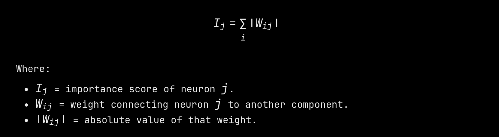
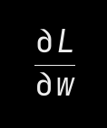
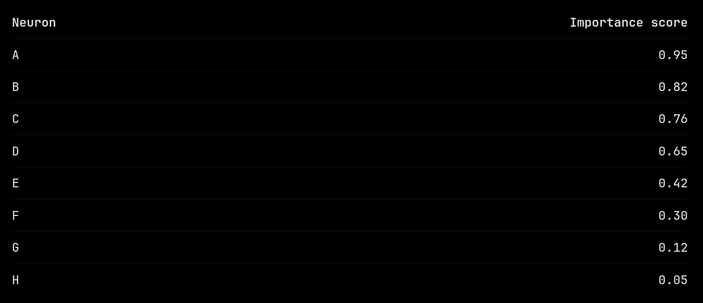
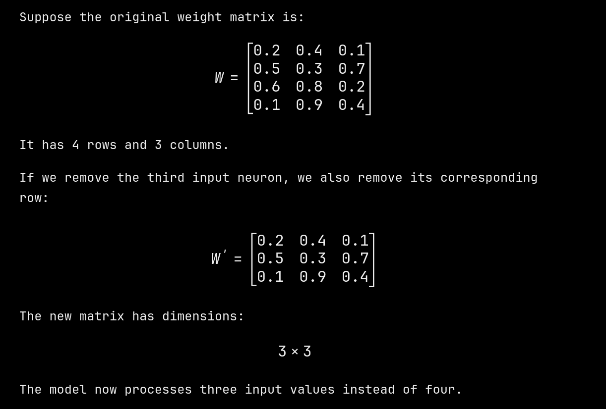
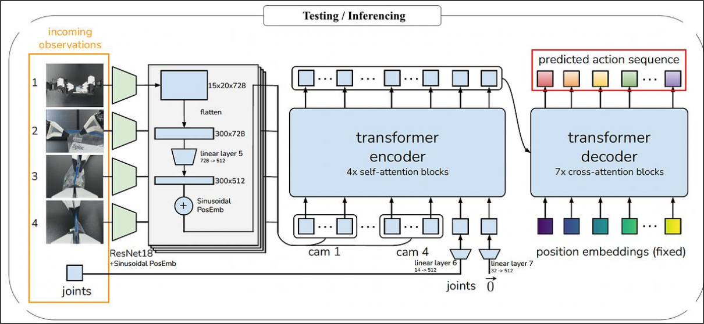

# Structured Pruning For Neural Networks

*Quick guide through Pruning: [https://www.youtube.com/watch?v=qDRLgT9qpTA*]

## What is Pruning?

The term "pruning" originated from gardening, meaning cutting away unnecessary branches. In technology, specifically for neural networks, "pruning" is a model compression technique that cuts off unwanted or unnecessary neural links in order to create a faster and more efficient network while maintaining accuracy.

There are two types of pruning:
- **Unstructured Pruning**
- **Structured Pruning**

- image slot here
## Quick look into Unstructured Pruning

Unstructured Pruning removes connections (weights) of neural networks, resulting in un-structured sparsity. Unstructured Pruning often leads to a high compression rate, but requires specific hardware or
library support for realistic acceleration. [1]

In other words, Unstructured Pruning reduce the weights of individual unnecessary connections to 0 without caring about the structure of the neural network. However, due to this chaotic dispersion of zeros, computers often have a hard time to process through these 0s, resulting almost to no change in latency unless specific hardwares or library support is used.

## Structured Pruning

### Definition

Structured pruning is a neural network compression technique that removes entire groups of components from a model to reduce its size and computational requirements.

A neural network has many and different components within it, some contribute significantly to the prediction while some contribute relatively insignificantly. Instead of pruning individual links, Structured Pruning removes the less important components entirely.

The components can be:
- Entire neurons(nodes)
- Entire channels
- Entire attention heads
- Entire Transformer layers

### How Structured Pruning works

Structured Pruning commonly starts with a pre-trained neural network. The pre-trained neural network already has parameters that allow it to perform certain tasks. The goal of pruning is to maintain performance while reducing the architecture of the neural network. 

Pruning can happen before, during, or after training, and the point where pruning is used may significantly impact how the network performs. [2]

#### Step 1: Evaluation

Before pruning, the algorithm needs to identify the unimportant components. This is called *importance scoring*. The process for evaluation is done mathematically and can be done in 4 ways.

**Weight magnitude**

This is one of the simplest approaches. The method simply checks the weights within a neuron and evaluates whether the neuron is important or not.

However, this approach has a limitation where it may incorrectly evaluate the importance of the neuron as that neuron, despite having small weights, may be important due to the inputs it receives and how it interacts with other neurons.

**Activation-based importance**

This approach observes what the neurons output when the neural network is processing data. An activation is the output of the neuron after processing its inputs. To evaluate a neuron, the method calculates the average absolute activation of a neuron. Neurons will low average activation will be removed.

This approach still has a limitation as a neuron with low average absolute activation value can still be highly informative for certain inputs.

**Gradient-based importance**

This approach examines how sensitive the network's loss is to changes in its components. A loss function measures the difference between the network's predictions and the desired outputs.

Example:
- Prediction: 0.8
- Target: 1.0
- Loss: 0.04 (using squared error)

If the loss increase significantly after removing a component, the component is presumed to be important. Gradient-based methods use derivatives to estimate how changes in parameters or components affect the loss.

For a parameter w, the gradient is:

**Taylor-based importance**
A Taylor approximation can estimate how much the loss changes when a component is removed.

Suppose a component is represented by a scaling variable $\(z\)$, where:
- $\(z=1\)$: component is retained.
- $\(z=0\)$: component is removed.
A first-order approximation gives:

$$\[
\Delta L \approx
\frac{\partial L}{\partial z}(0-1)
\]$$

The magnitude of this estimated change can be used as an importance measure.

If removing a component is estimated to cause a large loss increase, it is considered important.

#### Step 2: Selection

Firstly, the algorithm sorts the neurons from least important to most important. 

Secondly, the algorithm removes the amount of components based on a chosen ratio. 
For example, if we choose a 25% pruning ratio:
$\[
8\times0.25=2
\]$

Thirdly, there are two ways to allocate pruning: Global and Layer-wise. Global Pruning compares the scores across multiple layers and select the least importance ones in the network. Meanwhile, Layer-wise Pruning determine a separate ratio for each layers. Neither approaches are universally better.

#### Step 3: Cutting and Reconstructing

Consider two consecutive layers:
- Layer A has 4 neurons.
- Layer B has 3 neurons.
Every neuron in Layer A connects to neurons in Layer B through weights.

Suppose the pruning algorithm decides to remove neuron A3.

It is not enough to remove A3 visually. The algorithm must also remove:
1. The parameters that produce A3's output.
2. The connections carrying A3's output into Layer B.
3. The corresponding entries in the next layer's weight matrix.

This is because Layer B expects a specific number of input values. Once A3 is removed, its input dimension must also be reduced. Connecting components are also removed as layers are dependent on each other to remain mathematically valid.

**Reconstruction** means creating a valid, smaller architecture using the remaining components.

It can involve:
- Removing selected parameters.
- Rebuilding weight matrices with smaller dimensions.
- Adjusting connections between layers.
- Updating the model configuration.
- Copying the retained parameters into the new architecture.
Some pruning methods also use optimization to adjust the retained weights so that the new network's outputs resemble those of the original network.

#### Step 4: Fine-tuning pruned network

After pruning, fine-tune the remaining network to help recover lost performance. Then evaluate:
- Efficiency: Parameters, model size, memory usage, and inference speed.
- Performance: Accuracy and task performance.

If necessary, repeat pruning and fine-tuning gradually until the desired balance between efficiency and performance is achieved. 

Fine-tuning is needed as during training, neurons learn different relationships, so a neuron that does not have a high importance score may still be valuable. When that neuron is removed, the remaining network must operate without its contribution.

Consequently, the network's predictions might become less accurate and this is called performance degradation.

### Relevancy

ACT (Action Chunking with Transformers) contains several neural-network components that can be considered for Structured Pruning. The ACT architecture processes camera images and robot states, then predicts a chunk of future actions. Hence, reducing its internal components may reduce model size and computation.

Reference and Resources:
- [1][Structured Pruning for Neural Network - A Survey](https://arxiv.org/pdf/2303.00566)
- [2][Structured Pruning is All You Need for Pruning CNNs at Initialization](https://arxiv.org/pdf/2203.02549)
- [3][Tony Zhao's Paper on ACT and ALOHA system](https://www.roboticsproceedings.org/rss19/p016.pdf)