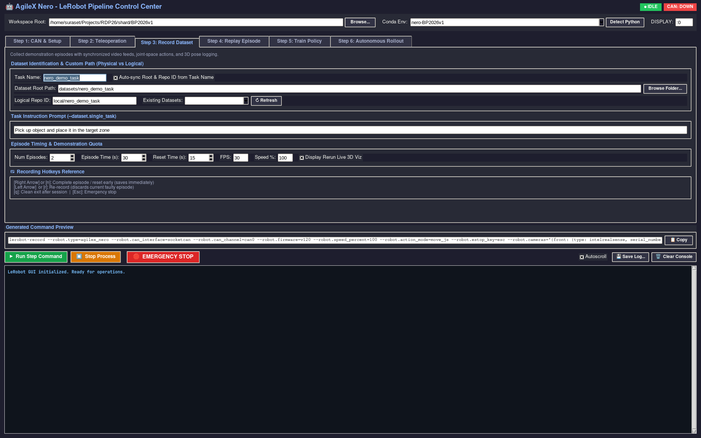

# EZ-GUI Documentation

**AgileX Nero – LeRobot Pipeline Control Center**
Source: `docs/lerobot_gui.py` · Project notes: `docs/d2/EZ-Gui.md`

EZ-GUI is a Tkinter desktop app that runs the whole AgileX Nero single-arm LeRobot workflow without typing terminal commands. Each step of the pipeline has its own tab. You fill in the fields, the GUI builds the matching `lerobot-*` command, and one button runs it. Output streams live into a console at the bottom of the window.

---

## 1. Quick Start

```bash
# From the machine connected to the arm (Python 3 with Tkinter)
python3 docs/lerobot_gui.py
```

Typical session:

1. **Top bar**: check that **Workspace Root** points to your LeRobot workspace (default `/home/sc1/BP2026v1`) and that **Conda Env** shows the right environment. Click **Detect Python** to confirm.
2. **Step 1**: type the sudo password and click **⚡ Bring Up CAN Interfaces**. The CAN badge in the header should turn green.
3. **Step 2**: teleoperate to check that the follower mirrors the leader.
4. **Step 3**: record demonstration episodes.
5. **Step 4**: replay an episode to check the recording.
6. **Step 5**: train an ACT policy.
7. **Step 6**: deploy the trained policy autonomously.

On every tab, **▶ Run Step Command** runs the command shown in the **Generated Command Preview** box.

> ⚠️ Only one process can run at a time. Stop the current process before you start another one.

---

## 2. Window Layout

```
┌──────────────────────────────────────────────────────────────────────┐
│ 🤖 AgileX Nero - LeRobot Pipeline Control Center   [● IDLE] [CAN: …] │  ← Header + status badges
│ Workspace Root [.......] [Browse]  Conda Env [▼] [Detect Python]  DISPLAY [:1] │
├──────────────────────────────────────────────────────────────────────┤
│ Step 1 │ Step 2 │ Step 3 │ Step 4 │ Step 5 │ Step 6                  │  ← Step tabs
│   (fields for the selected step)                                     │
├──────────────────────────────────────────────────────────────────────┤
│ Generated Command Preview [ lerobot-... ]              [📋 Copy]     │
│ [▶ Run Step Command] [⏹ Stop Process] [🛑 EMERGENCY STOP]            │
│                          [Autoscroll] [💾 Save Log...] [🗑️ Clear]    │
│ ┌──────────────────── live console output ────────────────────────┐  │
│ └─────────────────────────────────────────────────────────────────┘  │
└──────────────────────────────────────────────────────────────────────┘
```



### 2.1 Header badges

| Badge | Meaning |
|---|---|
| **● IDLE** (green) | Nothing is running. |
| **● RUNNING: \<step\>** (blue) | A command is running. The Run button is disabled. |
| **● STOPPED (E-STOP)** (red) | The Emergency Stop was pressed. |
| **CAN: can0 & can1 UP** (green) | Both CAN interfaces are up. |
| **CAN: can0 UP \| can1 DOWN** (yellow) | Only one interface is up. |
| **CAN: DOWN** (red) | Neither interface is up. |

The CAN badge refreshes every 5 seconds and after each command finishes. See [Known Issues](#7-known-issues--limitations) for its limits.

### 2.2 Top configuration bar

| Field | Purpose |
|---|---|
| **Workspace Root** | The working directory for every command. All relative paths (`datasets/...`, `outputs/...`) are resolved against it. Defaults to `/home/sc1/BP2026v1` if that folder exists; otherwise the folder the GUI was launched from. |
| **Conda Env** | The Python environment used to run commands. It is filled automatically from `/home/sc1/miniforge3/envs/`. The GUI prefers `nero-BP2026v1`, then `nero-RDP2026Nov`, `nero-singlearmRDPNov2026`, `lerobot`, and `base`. You can also type the full path to a Python binary. |
| **Detect Python** | Runs `python --version` on the selected env and prints the result in the console. |
| **DISPLAY** | The X display used for GUI windows such as Rerun. Defaults to `$DISPLAY`, or `:1` if that is not set. |

---

## 3. Step-by-Step Tabs

### Step 1 – CAN & Setup

Brings up the two CAN adapters and finds the RealSense cameras.

| Field | Default | Notes |
|---|---|---|
| Follower Arm Channel | `can0` | Used by every later step. |
| Leader Arm Channel | `can1` | Used by Steps 2 and 3. |
| Bitrate | `1000000` | |
| Sudo Password | *(empty)* | Hidden with `*`. Tick **Show Password** to reveal it. If it is empty, `sudo` will try to prompt and fail, because there is no terminal. |
| Front Camera (D435) | `261322076493` | RealSense serial number. |
| Wrist Camera (D405) | `260422274592` | RealSense serial number. |

| Button | What it runs |
|---|---|
| ⚡ Bring Up CAN Interfaces | For each channel: `ip link set down` → `type can bitrate <br>` → `up`, then `ip -details link show`. |
| 🔍 Check Interface Status | `ip -details link show can0 && ip -details link show can1` |
| 📡 Dump can0 / can1 | `candump can0` / `candump can1`. This keeps running until you click **Stop**. |
| 🔍 Scan RealSense Cameras | `lerobot-find-cameras realsense` |

The password is masked as `******` in the preview box and the console. **📋 Copy** copies the real, unmasked command.

### Step 2 – Teleoperation

Checks leader → follower mirroring before you record.

| Option | Effect |
|---|---|
| **A: WITHOUT cameras** | `--robot.cameras='{}'`. Lowest latency, joints only. |
| **B: WITH cameras** *(default)* | Adds the front and wrist RealSense streams and `--display_data=true`, which opens the Rerun 3D viewer. |

| Parameter | Default | Flag |
|---|---|---|
| Follower Speed % | 20 | `--robot.speed_percent` |
| Action Mode | `move_js` (or `move_j`) | `--robot.action_mode` |
| E-Stop Key | `esc` | `--robot.estop_key` |
| Leader Read Timeout (s) | 5.0 | `--teleop.read_timeout_s` |
| Mode Settle Time (s) | 1.0 | `--teleop.mode_switch_settle_s` |

**Rerun tips** (also shown in the tab): if the 3D view is hidden, click **+** → **3D**. Expand `world → nero` to see the joint transforms. Left-drag orbits, right-drag pans, and the scroll wheel zooms.

Runs: `lerobot-teleoperate --robot.type=agilex_nero ... --teleop.type=agilex_nero_leader ...`

### Step 3 – Record Dataset

Records demonstration episodes with `lerobot-record`.

**Dataset identification**

| Field | Default | Notes |
|---|---|---|
| Task Name | `nero_demo_task` | When **Auto-sync** is ticked, typing here also sets the Root Path to `datasets/<name>` and the Repo ID to `local/<name>`. |
| Dataset Root Path | `datasets/nero_demo_task` | The physical folder, relative to the workspace. Use **Browse Folder...** to pick one. |
| Logical Repo ID | `local/nero_demo_task` | The LeRobot dataset ID. |
| Existing Datasets | — | Lists the folders in `<workspace>/datasets/`. Picking one fills all three fields. Click **↻ Refresh** after you add new ones. |
| Task Instruction Prompt | `Pick up object and place it in the target zone` | Becomes `--dataset.single_task`. |

**Timing**

| Field | Default | Flag |
|---|---|---|
| Num Episodes | 2 | `--dataset.num_episodes` |
| Episode Time (s) | 30 | `--dataset.episode_time_s` |
| Reset Time (s) | 15 | `--dataset.reset_time_s` |
| FPS | 30 | `--dataset.fps` |
| Speed % | 100 | `--robot.speed_percent` |
| Display Rerun Live 3D Viz | ✔ | `--display_data` |

**Hotkeys while recording**

| Key | Action |
|---|---|
| `→` or `n` | Finish the episode early and save it. |
| `←` or `r` | Re-record and discard the current episode. |
| `q` | Exit cleanly after the session. |
| `Esc` | Emergency stop. |

> Hotkeys are read by the `lerobot-record` process, not by the GUI. Keep the focus where LeRobot can read the keyboard.

Datasets are always saved locally (`--dataset.push_to_hub=false`).

### Step 4 – Replay Episode

Plays a recorded episode back on the follower arm with `lerobot-replay`. No cameras and no leader arm are used.

| Field | Default | Notes |
|---|---|---|
| Available Datasets | — | Picking one fills the Root Path and Repo ID. |
| Dataset Root Path | `datasets/nero_demo_task` | |
| Logical Repo ID | `local/nero_demo_task` | |
| Episode Index | 0 | `--dataset.episode` |
| Speed % (Safety Clamp) | 20 (slider 10–100) | **20–30% is recommended.** |

### Step 5 – Train Policy

Trains an ACT (Action Chunking with Transformers) policy with `lerobot-train`.

| Field | Default |
|---|---|
| Training Dataset Root | `datasets/nero_demo_task` |
| Dataset Repo ID | `local/nero_demo_task` |
| Job Name | `act_nero_demo_task` |
| Output Directory | `outputs/train/act_nero_demo_task` |

**Presets** (each one fills in Steps, Batch Size, and Save Freq):

| Preset | Steps | Batch | Save Freq | Extra flags |
|---|---|---|---|---|
| Quick Sanity Test | 2,000 | 8 | 1,000 | — |
| **Standard Production** *(default)* | 60,000 | 16 | 10,000 | — |
| Smooth Motion | 80,000 | 16 | 10,000 | `--policy.temporal_ensemble_coeff=0.01 --policy.n_action_steps=1` |
| Custom | *(your values)* | | | — |

Other settings: **Device** (`cuda` or `cpu`), and **Resume from Checkpoint**, which adds `--resume=true --checkpoint_path=<path>`.

Fixed flags: `--policy.type=act --policy.push_to_hub=false --log_freq=200 --wandb.enable=false`.

### Step 6 – Autonomous Rollout

Runs a trained policy on the real arm with `lerobot-rollout`.

| Field | Default | Notes |
|---|---|---|
| Trained Models | — | Lists the folders in `<workspace>/outputs/train/`. It uses `checkpoints/last/pretrained_model` when that folder exists. |
| Policy Path | `outputs/train/act_conveyor_sort/checkpoints/last/pretrained_model` | Pick from the list or browse. **Check this before you run.** The default points to a different task than the other tabs. |
| Task Prompt | `Pick up object and place it in the target zone` | `--task`. It should match the prompt used for recording. |
| Duration (s) | 30 | **0 means it runs forever.** |
| Home Tol (rad) | 0.05 | `--robot.home_position_tol_rad` |
| Display Rerun Live 3D Pose | ✔ | `--display_data` |
| Speed % (Safety Clamp) | 20 (slider) | Always start at 20%. |

---

## 4. Execution Controls & Console

| Control | Behaviour |
|---|---|
| **▶ Run Step Command** | Runs the current tab's command in the background with `/bin/bash`. The working directory is the Workspace Root. |
| **⏹ Stop Process** | Sends `SIGINT` (like Ctrl+C) to the process group. If the process is still alive 2 s later, it sends `SIGTERM`. |
| **🛑 EMERGENCY STOP** | Sends `SIGKILL` to the process group straight away and resets the GUI state. |
| **📋 Copy** | Copies the full command, including the real password. You can paste it into a terminal. |
| **Autoscroll** | Keeps the console scrolled to the newest line. |
| **💾 Save Log...** | Saves the console contents to a `.txt` or `.log` file. |
| **🗑️ Clear Console** | Empties the console. |

Console colours: white = program output, blue = GUI system messages, green = success, red = errors and stops.

> 🛑 **The GUI E-Stop is a software stop.** It kills the Linux process; it does not cut motor power. Always keep the arm's hardware E-stop or the leader's `esc` key ready.

---

## 5. How It Works (Developer Notes)

### 5.1 Code structure

Everything is in one class, `LeRobotGUI(tk.Tk)`:

| Area | Methods |
|---|---|
| Theme | `setup_theme()`: dark "clam" theme. Input fields are white with black text (changed after user feedback). |
| Layout | `build_top_bar()`, `build_tabs()`, `build_step1_tab()` … `build_step6_tab()`, `build_bottom_panel()` |
| Discovery | `populate_conda_envs()`, `populate_existing_datasets()`, `populate_trained_models()`, `refresh_can_status()` |
| Command builders | `get_step1_command()` … `get_step6_command()`, routed by `get_current_command()` |
| Execution | `build_exec_environment()`, `run_command_in_background()`, `stop_active_process()`, `emergency_stop()` |
| Logging | `drain_output_queue()`, `log_system/success/danger()`, `save_console_log()` |

### 5.2 Execution flow

```
Run button
  └─ run_current_tab_command()
       └─ get_current_command()           → builds the CLI string from the tab fields
       └─ run_command_in_background()
            ├─ build_exec_environment()   → removes PYTHONPATH (ROS 2), adds conda bin/lib to the front of PATH/LD_LIBRARY_PATH, sets DISPLAY
            └─ worker thread: subprocess.Popen(shell=True, preexec_fn=os.setsid)
                  └─ each stdout line → output_queue
Tk main loop (every 50 ms)
  └─ drain_output_queue()  → strips ANSI codes, writes to the console, resets state on "DONE"
```

- Commands run in a **new process group** (`os.setsid`), so Stop and E-Stop can kill the whole tree.
- stdout and stderr are merged. The UI is only updated from the Tk thread, through the queue.
- The preview box is refreshed when you change tabs and when most fields change.

### 5.3 Customising defaults

Edit the constants at the top of `lerobot_gui.py`:

```python
DEFAULT_WORKSPACE    = "/home/sc1/BP2026v1"
DEFAULT_CONDA_BASE   = "/home/sc1/miniforge3"
PREFERRED_CONDA_ENVS = ["nero-BP2026v1", "nero-RDP2026Nov", ...]
DEFAULT_FRONT_CAMERA = "261322076493"
DEFAULT_WRIST_CAMERA = "260422274592"
```

Other defaults are hardcoded in the `get_stepN_command()` methods: firmware `v120`, camera resolution `640x480@30`, and `--robot.estop_key=esc` for record and rollout.

---

## 6. Troubleshooting

| Symptom | Likely cause / fix |
|---|---|
| "A command is already running!" | Click **Stop Process**, or wait for the current command to finish. |
| "Invalid Workspace" dialog | The Workspace Root does not exist. Fix it or click **Browse**. |
| CAN bring-up fails with a sudo error | The Sudo Password is empty or wrong. |
| `lerobot-*: command not found` | Wrong Conda Env. Pick the right one and click **Detect Python**. |
| Rerun window doesn't open | Check the **DISPLAY** value (`echo $DISPLAY` in a terminal). |
| Datasets or models dropdown is empty | Click **↻ Refresh** after you change the Workspace Root, record, or train. |
| Arm is in an error state | Use the arm's web admin page (in Chrome, with the admin password) to Stop → Clear Errors → Start. Starting teleoperation usually re-enables the arm automatically. |
| Preview looks out of date | Some fields (Batch Size, FPS, Speed in Step 3, Duration, Home Tol, CAN channels, camera serials) don't refresh the preview immediately. Switch tabs to refresh it. **Run always uses the current values**, so this only affects the display. |

---

## 7. Known Issues & Limitations

Collected from user testing (`docs/d2/EZ-Gui.md`) and a review of the code:

1. **Stop doesn't close the Rerun viewer.** Rerun starts as a separate process outside the command's process group, so Stop and E-Stop leave it open. Close it by hand.
2. **Closing the window doesn't stop the robot.** There is no `WM_DELETE_WINDOW` handler, and child processes run in their own session (`setsid`). If you close the GUI during a rollout (especially with Duration = 0), the arm keeps running. **Always click Stop before you close the GUI.** If it is still running, use `pkill -f lerobot-rollout`.
3. **The CAN badge can say "UP" when the arm is off.** The badge reports the Linux link state of the USB-CAN adapter, not whether the arm is responding. Also, the check looks for `"state UP"` anywhere in the `ip link` output, not per interface, so one up interface can make both look up.
4. **Arm faults must be cleared outside the GUI**, in the arm's web admin page (see Troubleshooting).
5. **The sudo password is passed via `echo ... | sudo -S`.** While the command runs, it can briefly appear in the system process list. **📋 Copy** puts the plain-text password on the clipboard.
6. **Prompts containing `"`** break the Step 3 and Step 6 commands, because the prompt is wrapped in double quotes without escaping.
7. **Invalid numbers** (for example, letters in a numeric field) make that field's preview/run fail with a Tk error in the terminal.

---

## 8. Roadmap (from user feedback)

- **AI error explanations**: explain failures in the console in plain language, so users know how to debug.
- **Leader/Follower status indicators**: show whether each arm is really alive, not just whether its CAN link is up. This probably needs the arm's web API and more research.
- Close-window handler that stops running processes (fixes issue 2).
- Kill the Rerun viewer on Stop (fixes issue 1).
- Per-interface CAN check with an arm heartbeat (fixes issue 3).
